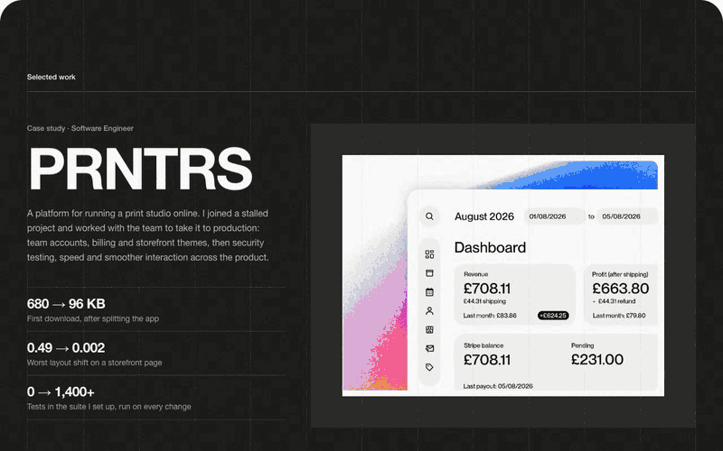
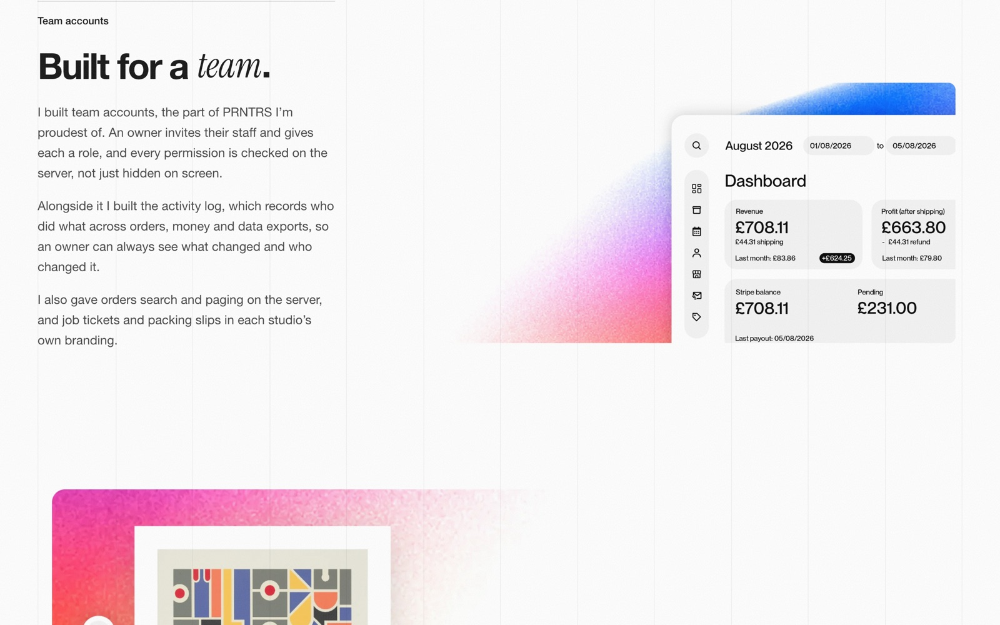
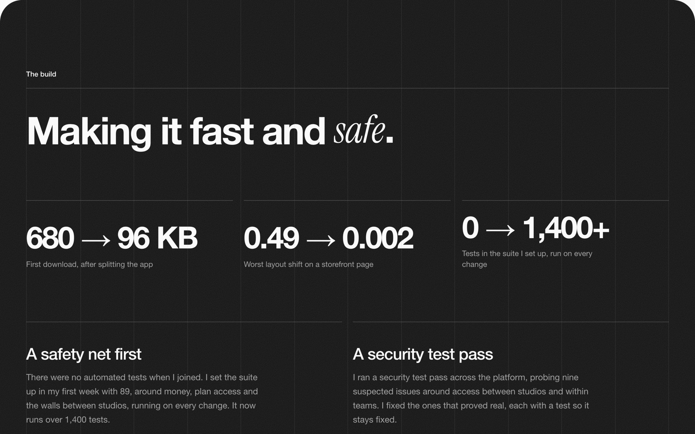
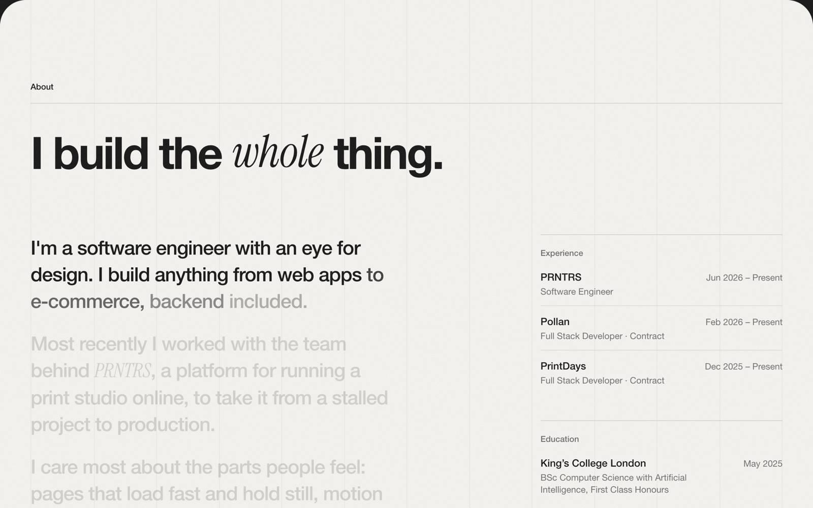

<div align="center">


# Sam Thomas — Portfolio

**The source for [madebysamthomas.com](https://madebysamthomas.com), the portfolio of a London-based software engineer.**
Swiss-style editorial layout, Helvetica and a single serif italic, with motion built from scratch and no animation library.

[**Visit the site ↗**](https://madebysamthomas.com) · [GitHub](https://github.com/sam-uel-thomas) · [LinkedIn](https://www.linkedin.com/in/sam-thomas-45a956293)

</div>

---

## ✦ A walk through the home page

<div align="center">

</div>

The page goes from the hero to the selected work, led by the PRNTRS case study and its headline numbers, then to About, with a CV-style timeline and stack list. It ends at a footer that sits *under* the page and is revealed as the content scrolls away. Scrolling is smoothed with [Lenis](https://lenis.darkroom.engineering/), and every heading and paragraph reveals itself as it comes into view.

## ✦ Case studies

<div align="center">

</div>

Opening a project plays a page transition, then the title arrives as a **springy wordmark**: its letters rise into place and lean away from the cursor, run by a small damped-spring simulation. Each case study is laid out as a zigzag of screenshots and story, followed by a dark "The build" section with before-and-after numbers.

<table>
<tr>
<td width="50%"></td>
<td width="50%"></td>
</tr>
</table>

## ✦ Pages

<table>
<tr>
<td width="50%" align="center"><br /><sub><b>Selected work</b></sub></td>
<td width="50%" align="center"><br /><sub><b>About</b></sub></td>
</tr>
<tr>
<td width="50%" align="center"><br /><sub><b>Case study</b></sub></td>
<td width="50%" align="center"><br /><sub><b>Footer &amp; contact</b></sub></td>
</tr>
</table>

## ✦ Built with

| | |
|---|---|
| **Framework** | [Next.js 14](https://nextjs.org/) (App Router) · React 18 · TypeScript |
| **Styling** | [Tailwind CSS](https://tailwindcss.com/) on a 12-column grid · a custom `ink` / `paper` / `canvas` palette |
| **Type** | Helvetica Neue for everything, plus [Instrument Serif](https://fonts.google.com/specimen/Instrument+Serif) italic for accents |
| **Scrolling** | [Lenis](https://lenis.darkroom.engineering/) smooth scroll |
| **Motion** | Hand-written: IntersectionObserver reveals, `requestAnimationFrame` parallax, a fixed-step spring integrator |
| **SEO & sharing** | Generated Open Graph images (`next/og`), sitemap and robots.txt |
| **Hosting** | [Vercel](https://vercel.com/) with Speed Insights |

## ✦ Details worth a look

- **No animation library.** Reveals, parallax, magnetic links, the rolling hero word and the springy wordmark are all hand-written components. They share one easing curve and a spring integrator from [`lib/motion.ts`](lib/motion.ts). The spring runs at a fixed 1/240 s substep, so it bounces the same on 60 Hz and 120 Hz screens.
- **Respects reduced motion.** With `prefers-reduced-motion` turned on, smooth scrolling, parallax and the intro are switched off and the page still reads fine. Text reveals only hide text when JavaScript is running, so the page is readable without it.
- **All content in one file.** Copy, projects, case studies, the rolling hero words and availability all live in [`content/site.ts`](content/site.ts). Add a `caseStudy` to a project and its `/work/[slug]` page is generated at build time.
- **Generated share cards.** Each page's Open Graph image is rendered from the same content, so link previews always match the site.
- **A playground.** [`/playground`](app/playground/page.tsx) is a scratch page for trying out new ideas with the site's own components before they go into the real pages.

## ✦ Project structure

```
app/
├── page.tsx               # Home: Hero → Work → Testimonials → About
├── work/[slug]/           # Statically generated case studies (+ OG image)
├── playground/            # Scratch page for new motion and layout ideas
└── layout.tsx             # Fonts, intro, page transition, smooth scroll
components/                # Hero, WorkLead, SpringyWordmark, TextReveal, Magnetic…
content/site.ts            # Every word on the site
lib/                       # Motion maths and the shared Lenis handle
```

## ✦ Running locally

```bash
npm install
npm run dev
```

Then open [localhost:3000](http://localhost:3000). Set `NEXT_PUBLIC_SITE_URL` to give canonical URLs and share cards a production domain; otherwise they fall back to Vercel's production host or localhost.

---

<div align="center"><sub>Designed and built by Sam Thomas · <a href="https://madebysamthomas.com">madebysamthomas.com</a></sub></div>
