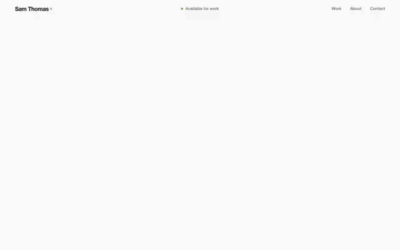
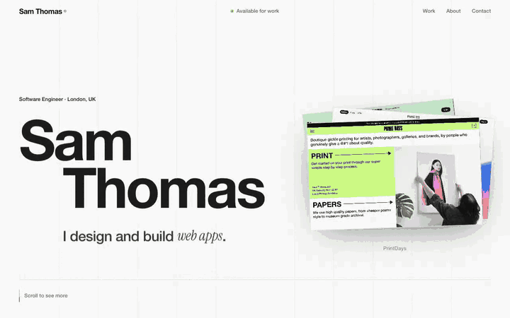
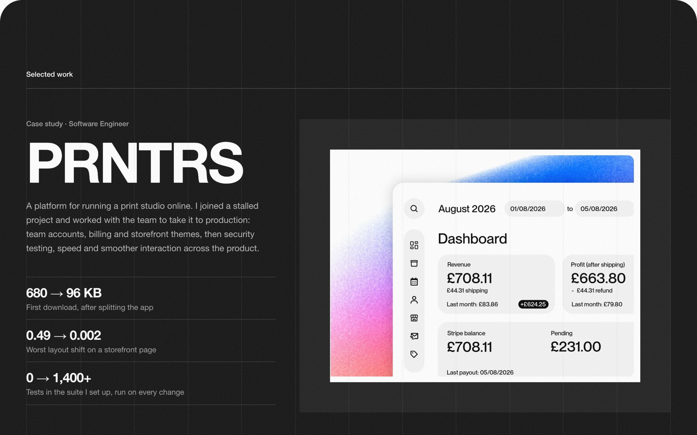
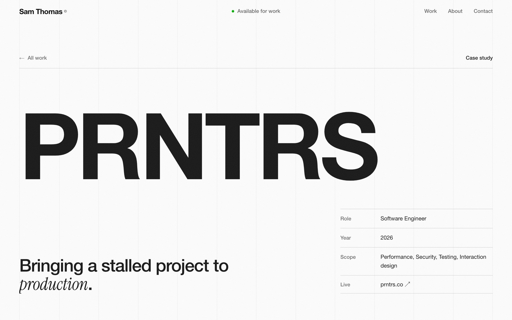
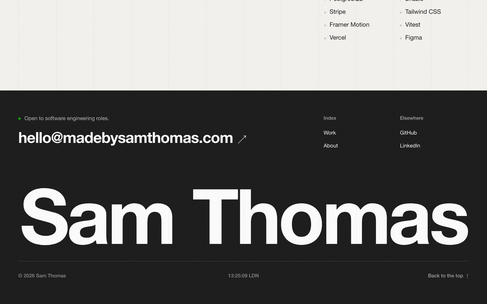

<div align="center">



# Sam Thomas — Portfolio

**This is the code behind [madebysamthomas.com](https://madebysamthomas.com), my portfolio. Designed and built by me (obviously)**

[**Visit the site ↗**](https://madebysamthomas.com) · [GitHub](https://github.com/sam-uel-thomas) · [LinkedIn](https://www.linkedin.com/in/sam-thomas-45a956293)

</div>

---

## ✦ The home page

<div align="center">

</div>

I wanted the site to lead with the work, so the home page goes straight from the hero into it. PRNTRS comes first, with stats showing what I brought to the team. After that comes About, which I set out like the top of my CV, and the page ends on a footer that's revealed underneath as you scroll. Getting in touch lives there, so every page ends on it.

## ✦ Case studies

<div align="center">

</div>

A case study opens with the project's name on a cover, then its letters spring into place and lean away from your cursor. The page leads with my role, because that's what someone reading a case study came for. Then it zigzags between screenshots and what I built.

<table>
<tr>
<td width="50%"></td>
<td width="50%"></td>
</tr>
</table>

## ✦ Pages

<table>
<tr>
<td width="50%" align="center"><br /><sub><b>Selected work</b></sub></td>
<td width="50%" align="center"><br /><sub><b>About</b></sub></td>
</tr>
<tr>
<td width="50%" align="center"><br /><sub><b>Case study</b></sub></td>
<td width="50%" align="center"><br /><sub><b>Footer &amp; contact</b></sub></td>
</tr>
</table>

## ✦ What I built it with

| | |
|---|---|
| **Framework** | [Next.js 14](https://nextjs.org/) (App Router) · React 18 · TypeScript |
| **Styling** | [Tailwind CSS](https://tailwindcss.com/) on a 12-column grid, with my own ink, paper and canvas palette |
| **Type** | Helvetica Neue for almost everything, plus [Instrument Serif](https://fonts.google.com/specimen/Instrument+Serif) italic for the odd accented word |
| **Scrolling** | [Lenis](https://lenis.darkroom.engineering/) smooth scroll |
| **Motion** | My own: IntersectionObserver reveals, `requestAnimationFrame` parallax and a small spring simulation |
| **SEO & sharing** | Generated Open Graph images (`next/og`), a sitemap and robots.txt |
| **Hosting** | [Vercel](https://vercel.com/), with Speed Insights |

## ✦ Things I cared about

- **I wrote the motion myself.** There's no animation library. The reveals, parallax, magnetic links, rolling hero word and springy wordmark are all my own components, sharing one easing curve and a spring from [`lib/motion.ts`](lib/motion.ts). I run the spring in small fixed steps, so it bounces the same on a 60 Hz screen as on a 120 Hz one.
- **It still works if you'd rather it didn't move.** If you've turned on reduced motion, the smooth scrolling, parallax and intro switch off and the page reads just as well. Text only waits to reveal itself when JavaScript is running, so without it you still get every word.
- **All the content lives in one file.** Every word on the site is in [`content/site.ts`](content/site.ts): the projects, case studies, hero words and whether I'm available. When I give a project a `caseStudy`, its `/work/[slug]` page is built at deploy time.
- **The link previews make themselves.** Each page's share image is generated from that same content, so a preview never goes out of date.
- **I keep a playground.** [`/playground`](app/playground/page.tsx) is where I try ideas out with the site's own components before they go anywhere near the real pages.

## ✦ How it's laid out

```
app/
├── page.tsx               # Home: Hero → Work → Testimonials → About
├── work/[slug]/           # Case studies, built at deploy time (+ share image)
├── playground/            # Where I try out new motion and layout ideas
└── layout.tsx             # Fonts, intro, page transition, smooth scroll
components/                # Hero, WorkLead, SpringyWordmark, TextReveal, Magnetic…
content/site.ts            # Every word on the site
lib/                       # Motion maths and the shared Lenis handle
```

## ✦ Running it locally

```bash
npm install
npm run dev
```

Then open [localhost:3000](http://localhost:3000). If you set `NEXT_PUBLIC_SITE_URL`, canonical links and share images use that domain. Without it they fall back to Vercel's production host, or to localhost.

---

<div align="center"><sub>Designed and built by me, Sam Thomas · <a href="https://madebysamthomas.com">madebysamthomas.com</a></sub></div>
